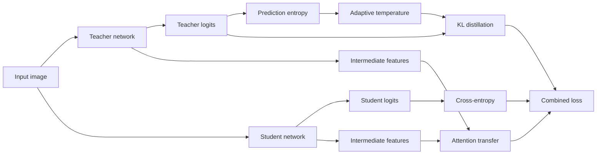

<div align="center">

# Adaptive Temperature + Attention-map Distillation

### Entropy-guided knowledge distillation for compact image classifiers

[](https://www.python.org/)
[](https://pytorch.org/)
[](https://www.cs.toronto.edu/~kriz/cifar.html)
[](#)

在标准 logits 蒸馏的基础上，引入基于教师预测熵的自适应温度，并通过 Attention Transfer 对齐教师与学生的中间层特征。

</div>

## 项目简介

针对固定温度难以适配不同样本信息量的问题，根据教师输出的预测熵动态调整软标签蒸馏温度；同时使用中间层 Attention Map 约束学生特征，并在 ResNet56→ResNet20、ResNet110→ResNet32、VGG16→VGG11 三组教师—学生模型上进行实验。

## 方法设计

对每个样本计算教师预测熵，并将其归一化后映射为温度：

```text
T_i = T_base × (1 + H(p_teacher_i) / H_max)
```

联合优化以下三部分损失：

```text
L = (1 - α) · L_CE + α · L_KD + β · L_Attention
```

- `L_CE`：学生预测与真实标签的交叉熵。
- `L_KD`：基于自适应温度的 KL 散度蒸馏损失。
- `L_Attention`：教师和学生中间层 Attention Map 的 L2 对齐损失。



## 实验结果

> 下表中的结果来自仓库内的项目报告 [`performance.pdf`](performance.pdf)，指标均为 CIFAR-100 Top-1 Accuracy。

| Teacher → Student | Teacher | Student | CE only | Standard KD | KD + AT | KD + Adaptive T | **Ours** |
| --- | ---: | ---: | ---: | ---: | ---: | ---: | ---: |
| ResNet56 → ResNet20 | 74.23 | 69.82 | 68.80 | 70.66 | 71.40 | 71.90 | **72.10** |
| ResNet110 → ResNet32 | 76.58 | 71.26 | 71.26 | 71.73 | 71.96 | 72.21 | **72.88** |
| VGG16 → VGG11 | 72.93 | 68.64 | 68.64 | 69.38 | 70.62 | 70.21 | **70.85** |

相较仅使用交叉熵的学生模型，完整方案分别提升 **2.08、1.62 和 1.21 个百分点**；相较普通 KD，在三个模型组合上分别提升 **1.44、1.15 和 1.47 个百分点**。

## 项目亮点

- **自适应温度**：根据教师预测熵逐样本调整蒸馏强度，避免固定温度对不同难度样本使用相同软标签分布。
- **中间层特征对齐**：将二维特征图转换为通道注意力图，通过 L2 损失约束教师与学生的空间关注区域。
- **多模型组合验证**：覆盖 ResNet56→ResNet20、ResNet110→ResNet32 和 VGG16→VGG11。
- **模块化训练脚本**：教师预训练、普通 KD、自适应温度蒸馏分别为独立入口，便于进行消融实验。

## 快速开始

```bash
git clone https://github.com/luo411422-hue/Adaptive-Temperature-KD.git
cd Adaptive-Temperature-KD
pip install -r requirements.txt
```

CIFAR-100 会在首次运行时自动下载。训练脚本当前保留了实验机器的本地路径配置，运行前请检查并修改以下变量：

- `data_root`：CIFAR-100 数据目录。
- `teacher_ckpt`：教师模型的最佳权重路径。
- `student_ckpt`：学生模型权重保存路径。

推荐流程：

```bash
# 1. 训练 ResNet56 教师
python Ter_resnet56.py

# 2. 使用 ResNet56 → ResNet20 进行自适应温度与特征蒸馏
python "KD_resnet56&20.py"
```

其他入口：

| 脚本 | 教师 → 学生 |
| --- | --- |
| `KD_resnet56&20.py` | ResNet56 → ResNet20 |
| `KD_resnet110&32.py` | ResNet110 → ResNet32 |
| `KD_VGG.py` | VGG16 → VGG11 |

可将脚本中的 `normal_KD` 配置切换为普通 logits 蒸馏，作为对照实验。

## 仓库结构

```text
.
├── Ter_resnet56.py          # ResNet56 教师训练
├── KD_resnet56&20.py        # 自适应温度 + 特征蒸馏
├── KD_resnet110&32.py       # ResNet110 → ResNet32 实验
├── KD_VGG.py                # VGG16 → VGG11 实验
├── dataset.py               # CIFAR-10 / CIFAR-100 数据加载
├── models/                  # ResNet 与 VGG 网络实现
├── plot.py                  # 性能对比图
└── performance.pdf          # 实验结果表
```

## 复现说明

- 实验使用 CIFAR-100，训练集按 9:1 划分训练集与验证集。
- 自适应温度、特征蒸馏和普通 KD 共用相同数据划分与评估流程。
- 教师权重、学生权重和数据集不包含在仓库中，需要按脚本自行训练或准备。
- 训练集与测试集指标应在相同输入尺寸、数据划分和设备条件下比较。

## 致谢

项目的数据加载和训练框架参考 [`pytorch-cifar`](https://github.com/kuangliu/pytorch-cifar) 与论文 [*Distilling the Knowledge in a Neural Network*](https://arxiv.org/abs/1503.02531)，在此基础上实现自适应温度与 Attention Transfer 联合蒸馏。
